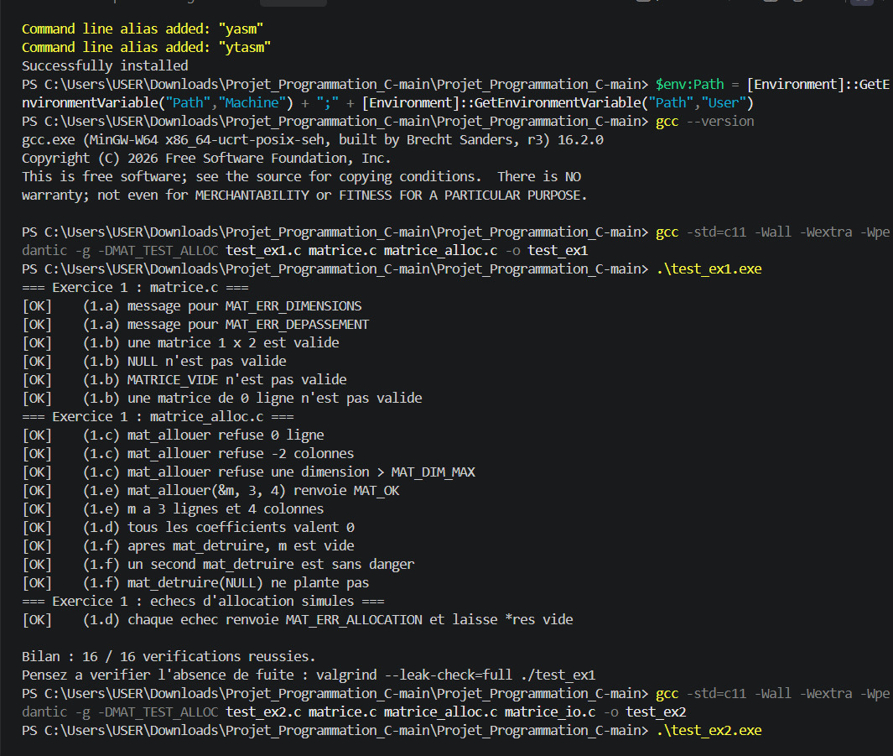
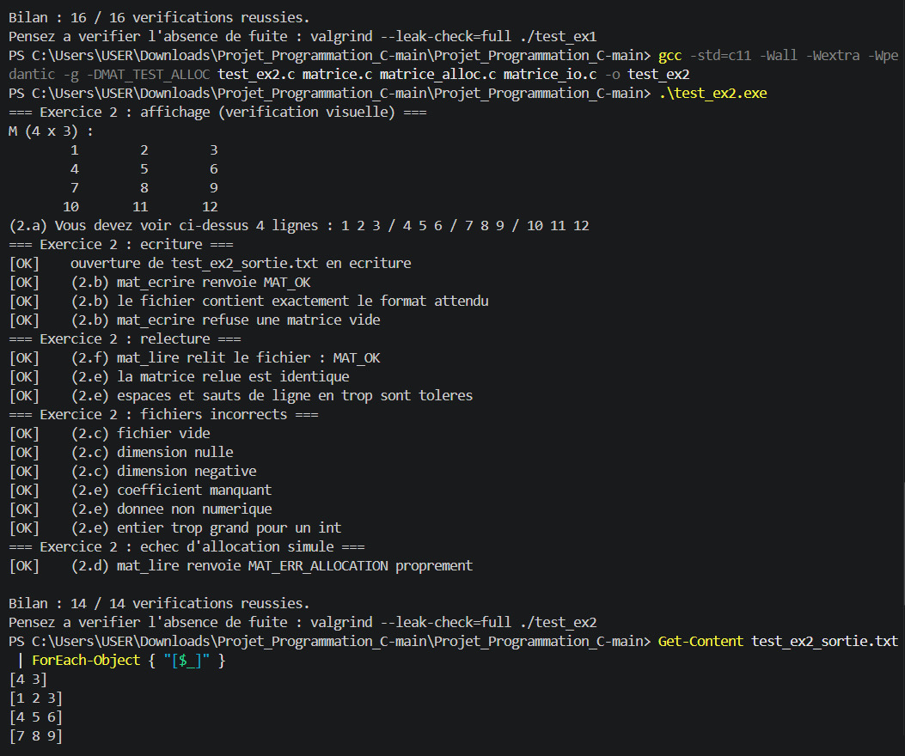
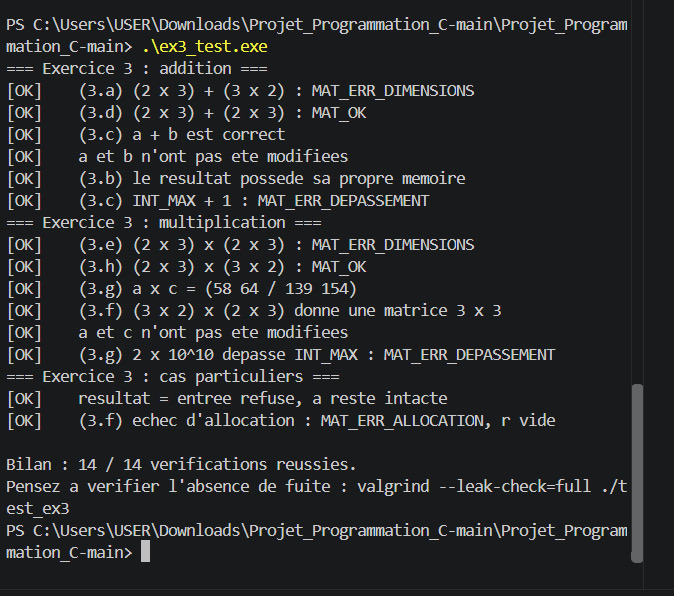
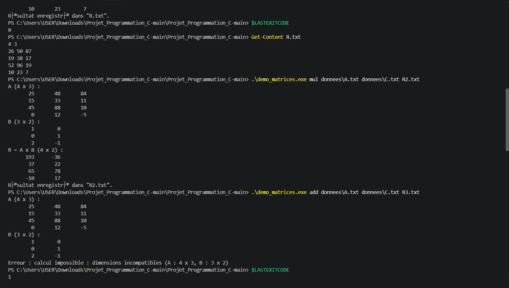
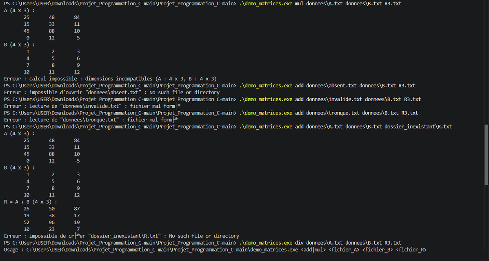
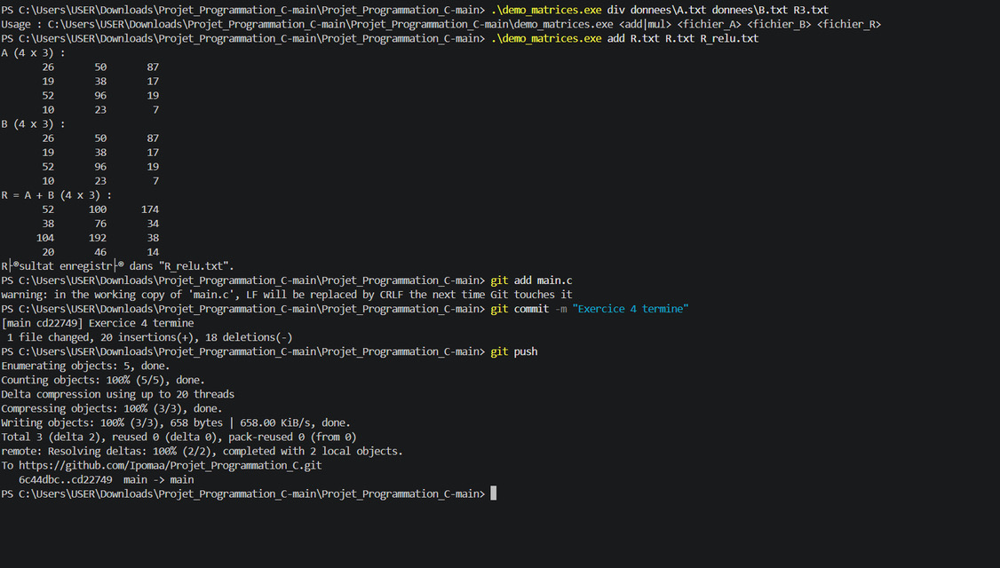

# TD — Stockage de matrices en C

**Programmation modulaire et séparée, fichiers texte et allocation dynamique**

| Membre | Identifiant GitHub |
|---|---|
| NEGRA Ahmed | [@NegraAhmed](https://github.com/NegraAhmed) |
| COURTOIS Léandre | [@Ipomaa](https://github.com/Ipomaa) |

- **Formation :** 3e année STI — INSA Centre Val de Loire
- **Groupe de TD :** NEGRA Ahmed, COURTOIS Léandre
- **Date de remise :** 
- **Dépôt :** [Ipomaa/Projet_Programmation_C](https://github.com/Ipomaa/Projet_Programmation_C)

## Table des matières

1. [Introduction](#1-introduction)
2. [Exercice 1 : allocation et destruction](#2-exercice-1--allocation-et-destruction)
3. [Exercice 2 : entrées-sorties](#3-exercice-2--entrées-sorties)
4. [Exercice 3 : calcul matriciel](#4-exercice-3--calcul-matriciel)
5. [Exercice 4 : démonstration complète](#5-exercice-4--démonstration-complète)

---

## 1. Introduction

### Le problème

L'objectif du TD est d'écrire une petite bibliothèque C permettant de créer, sauvegarder, relire, afficher, additionner et multiplier des matrices d'entiers de taille quelconque. Une matrice est représentée par une structure `Matrice` qui contient ses dimensions et un tableau de pointeurs de lignes (`int **coef`), chaque ligne étant allouée séparément dans le tas.

La bibliothèque est découpée en quatre modules, chacun formé d'un fichier d'en-tête (`.h`, l'interface) et d'un fichier d'implémentation (`.c`) :

| Module | Rôle |
|---|---|
| `matrice` | type `Matrice`, codes d'erreur `MatErreur`, outils communs |
| `matrice_alloc` | création et destruction d'une matrice |
| `matrice_io` | lecture, écriture et affichage d'une matrice (fichier texte) |
| `matrice_calcul` | addition et multiplication de deux matrices |

Un programme de démonstration (`main.c`) utilise ces modules : il lit deux matrices dans des fichiers, calcule leur somme ou leur produit, affiche le résultat et l'enregistre. Toutes les fonctions qui peuvent échouer renvoient un code `MatErreur` et respectent des règles de propriété de la mémoire (R1 à R7), afin d'éviter toute fuite, y compris en cas d'erreur.

### Objectifs du TD

- séparer l'interface d'un module (`.h`) de son implémentation (`.c`) ;
- compiler séparément plusieurs modules, puis les assembler par édition de liens ;
- allouer dynamiquement une matrice à deux niveaux, en gérant l'échec partiel d'allocation ;
- respecter des règles de propriété de la mémoire (qui alloue, qui libère) ;
- lire et écrire un fichier texte en vérifiant chaque opération ;
- programmer l'addition et la multiplication en contrôlant les dimensions et le dépassement de capacité ;
- mettre en place une gestion d'erreurs uniforme et la vérifier par des tests.

### État du projet à la remise

**Les exercices 1 à 4 sont complets.**

| Exercice | Fichier(s) complété(s) | Résultat |
|---|---|---|
| 1 — Allocation et destruction | `matrice.c`, `matrice_alloc.c` | `test_ex1` : **16 / 16** |
| 2 — Entrées-sorties | `matrice_io.c` | `test_ex2` : **14 / 14** |
| 3 — Calcul matriciel | `matrice_calcul.c` | `test_ex3` : **14 / 14** |
| 4 — Démonstration complète | `main.c` | **10 / 10** scénarios de la section 6.5 conformes |

- Tous les fichiers compilent **sans aucun avertissement** avec `-std=c11 -Wall -Wextra -Wpedantic`.
- Il ne reste aucune ligne provisoire dans les fichiers complétés.
- Le fichier produit par le scénario 1 est relu correctement par le programme lui-même (`add R.txt R.txt R2.txt`).
- `valgrind --leak-check=full` affiche *All heap blocks were freed* et 0 erreur pour `test_ex1`, `test_ex2`, `test_ex3` et `demo_matrices`.

**Limites et remarques :**

- Nous avons compilé et exécuté les tests sous Windows (gcc MinGW 16.2). **valgrind n'existant pas sous Windows**, nous avons vérifié les fuites mémoire sous **Linux**. L'outil équivalent sous Windows, Dr. Memory, s'arrête avec une erreur interne avec notre version de gcc : nous n'avons donc pas pu l'utiliser.
- Sous Windows, le *Contrôle intelligent des applications* bloquait l'exécution des programmes compilés (exécutables non signés). Nous avons dû le désactiver pour lancer les tests.
- Les réponses aux questions de réflexion se trouvent dans la section de chaque exercice.

---

## 2. Exercice 1 : allocation et destruction

### Dans l'exercice 1, on a créer et détruit une matrice de taille quelconques sur le tas. Et ensuite, la libérer sans fuite.

- Nous avons rajouté comme code pour :
**- 1.a :**
```c
case MAT_ERR_DIMENSIONS: return "dimensions incompatibles";
case MAT_ERR_DEPASSEMENT: return "depassement arithmetique";
```
**- 1.b :**
```c
return m != NULL
    && m->coef != NULL
    && m->nb_lignes >= 1 && m->nb_lignes <= MAT_DIM_MAX
    && m->nb_colonnes >= 1 && m->nb_colonnes <= MAT_DIM_MAX;
```
**-1.c :**
```c
if (nb_lignes < 1 || nb_lignes > MAT_DIM_MAX
    || nb_colonnes < 1 || nb_colonnes > MAT_DIM_MAX)
    return MAT_ERR_ARGUMENT;
```
**-1.d :**
```c
for (int i = 0; i < nb_lignes; i++) {
    coef[i] = mat_calloc((size_t)nb_colonnes, sizeof *coef[i]);

    if (coef[i] == NULL) {
        for (int k = i - 1; k >= 0; k--)
            free(coef[k]);

        free(coef);
        return MAT_ERR_ALLOCATION;
    }
}
```
**-1.e :** 
```c
res->coef = coef;
res->nb_lignes = nb_lignes;
res->nb_colonnes = nb_colonnes;

return MAT_OK;
```
**-1.f :**
```c
if (m->coef != NULL) {
    for (int i = 0; i < m->nb_lignes; i++)
        free(m->coef[i]);

    free(m->coef);
}
```
 A la compilation tout marche très bien et on reçoit " Bilan : 16 / 16 verifications reussies. ". Et valgrind affiche bien " All heap blocks were freed ".

### Questions : 

 **-Q3.1 :** mat_detruire prend une Matrice * car il faut que la fonction puisse directement modifier la Matrice originelle et la remettre à l'état vide après avoir libéré sa mémoire. Si on utilise pas un pointeur vers la Matrice, alors la fonction va simplement modifier une copie. Il nous faut l'adresse de la matrice pour directement modifier la matrice originelle. Si on l'appeler avec un passage par valeur la mémoire pointée par coef serait bien libérée mais matrice. La mémoire serait libérée mais le pointeur de la matrice originelle ne serait pas remis à NULL. matrice.coef contient donc maintenant une adresse mémoire plus valide.

 **-Q3.2 :** Pour une matrice n*p il faut n + 1 appels à calloc car il en faut un pour allouer le tableau de pointeurs. Et il en faut n appels pour allouer séparement chaque lignes de la matrice.
 Maintenant pour libérer la mémoire, il faut faire l'inverse n appels à free pour libérer chaque lignes du tableau. Et un appel free en plus pour libérer le tableau de pointeurs. 
 Si la k-ième allocation échoue, alors il faudra libérer k - 1. Car il y aura eu k - 1 appels validés avant. 

 **-Q3.3 :** La fonction mat_detruire peut être appelée deux fois car une fois la première libération on remet la matrice à l'état vide. Donc comme matrice.coef vaudra NULL, la fonction ne libérera rien. En revanche ce n'est pas vrai si on crée une copie de notre matrice a. En effet, le premier appel à libération, remet a à zéro. Mais b n'est pas modifiée et son pointeur contient toujours l'ancienne adresse mémoire plus valide. b n'est pas remis à NULL. Le deuxième appel crée donc un comportement indéterminé. 

 **-Q3.4 :** mat_allouer commence par *res = MATRICE_VIDE car on veut être sûr d'avoir une allocation qui n'échoue pas. Sans initialisation de res, on est pas sûr que res ne contient pas d'anciennes valeurs mémoires. En l'initialisant, on a plus de doute et coef vaut NULL, nb_lignes et nb_colonnes sont remis à zéro. 


## 3. Exercice 2 : entrées-sorties

### Dans l'exercice 2, on veut afficher une matrice, l'enregistrer dans un fichier texte puis la relire en détectant toute donnée invalide.

- Nous avons rajouté comme code :

**- 2.a :**
```c
for (int i=0; i < m->nb_lignes; i++){
        for (int j=0; j < m->nb_colonnes; j++){
            printf(" %8d", m->coef[i][j]);
        }
        putchar('\n');
}
```
**- 2.b :**
```c
for (int i=0; i < m->nb_lignes; i++){
        for (int j=0; j < m->nb_colonnes; j++){
            if (fprintf(f, j == 0 ? "%d" : " %d", m->coef[i][j]) < 0)
                return MAT_ERR_ECRITURE;
        }

        if ( fputc('\n', f) == EOF )
            return MAT_ERR_ECRITURE;

        
    }
    if (fflush(f) == EOF)
        return MAT_ERR_ECRITURE;

    return MAT_OK;
```
**- 2.c : **
```c
 if ( 1 > nb_lignes || nb_lignes > MAT_DIM_MAX || 1 > nb_colonnes || nb_colonnes > MAT_DIM_MAX )
        return MAT_ERR_FORMAT;
```
**- 2.d :**
```c
Matrice tmp;
err = mat_allouer(&tmp, nb_lignes, nb_colonnes);

if (err != MAT_OK)
    return err;
```
**- 2.e :**
```c
for (int i = 0; i < nb_lignes; i++) {
    for (int j = 0; j < nb_colonnes; j++) {
        err = lire_entier(f, &tmp.coef[i][j]);

        if (err != MAT_OK) {
            mat_detruire(&tmp);
            return err;
        }
    }
}
```
**- 2.f :**
```c
*res = tmp;
return MAT_OK;
```

 A la compilation tout marche très bien et on reçoit " Bilan : 14 / 14 verifications reussies. ". Et valgrind affiche bien " All heap blocks were freed ".

### Questions : 

**-Q4.1 :** On remplit d'abord une matrice temporaire pour modifier la matrice de sortie que quand la lecture est entièrement reussie. Avec ça, on peut directement détruire la matrice temporaire sans laisser res partiellement vide s'il y a une erreur. 

**-Q4.2 :** Non la lecture ne vérifie pas que chaque ligne de la matrice est sur sa propre ligne de texte. En effet, dans la fonction lire_entier, on utilise fscanf avec %s qui lit les éléments séparés par un espace, tabulations  ou retours à la ligne. Le programme récupère donc bien les coefficients dans le bon ordre. C'est ce qui importe le plus. C'est ce qu'on appelle une lecture tolérante. Le programme accepte plusieurs organisations entre les espaces, tabulations ou retours à la ligne.

**-Q4.3 :** Comme le flux est positionné juste après le dernier coefficient lu, on peut appeler plusieurs fois la fonction mat_lire sur le même fichier. Chaque appel reprend la lecture à l'endroit où le précédent s'est arrêté. Cela permet donc de stocker plusieurs matrices à la suite dans un même fichier et de les lire successivement sans devoir rouvrir le fichier à chaque fois.

**-Q4.4 :** La fonction mat_ecrire utilise fflush() pour forcer l'écriture des données qui se trouvent dans le tampon. Grace à ça, on peut détecter une eventuelle erreur d'écriture avant de renvoyer MAT_OK car ça serait faux. Cependant, ça ne dispense pas l'appelant de vérifier le résultat de fclose car il peut toujours y avoir une erreur à la fermeture du fichier.


## 4. Exercice 3 : calcul matriciel

### Dans l'exercice 3, on veut additionner et/ou multiplier deux matrices entre elles, en vérifiant leurs dimensions mais sans modifier les matrices d'entrées. Le résultat possède sa propre mémoire.

- Nous avons rajouté comme code :

**- 3.a :** 
```c
if (a->nb_lignes != b->nb_lignes
    || a->nb_colonnes != b->nb_colonnes)
    return MAT_ERR_DIMENSIONS;
```
**- 3.b :** 
```c
Matrice r = MATRICE_VIDE;
err = mat_allouer(&r, a->nb_lignes, a->nb_colonnes);

if (err != MAT_OK)
    return err;
```
**- 3.c :** 
```c
long long s = (long long)a->coef[i][j] + b->coef[i][j];
```
**- 3.d :** 
```c 
*res = r;
return MAT_OK;
```
**- 3.e :** 
```c
if (a->nb_colonnes != b->nb_lignes)
    return MAT_ERR_DIMENSIONS;
```
**- 3.f :** 
```c
Matrice r = MATRICE_VIDE;
err = mat_allouer(&r, a->nb_lignes, b->nb_colonnes);

if (err != MAT_OK)
    return err;
```
**- 3.g :** 
```c
long long s = 0;
for (int k = 0; k < a->nb_colonnes; k++) {
    long long p = (long long)a->coef[i][k] * b->coef[k][j];

    if ((p > 0 && s > LLONG_MAX - p)
        || (p < 0 && s < LLONG_MIN - p)) {
        mat_detruire(&r);
        return MAT_ERR_DEPASSEMENT;
    }

    s += p;
}
r.coef[i][j] = (int)s;
```
**- 3.h :** 
```c
*res = r;
return MAT_OK;
```

 A la compilation tout marche très bien et on reçoit " Bilan : 14 / 14 verifications reussies. ". Et valgrind affiche bien " All heap blocks were freed ".

### Questions :

**-Q5.1 :** Non le le paramètre const Matrice *a n'empêche pas d'écrire a->coef[0][0] = 7. const protège la structure Matrice et fait en sorte qu'on ne puisse pas directement modifier ses champs à travers a. Mais comme coef est un pointeur vers un tableau de pointeurs vers des entiers, le const ne protège pas les valeurs pointées. L'instruction reste autorisée. Pour refuser cette affectation, il faudrait aussi déclarer les coefficients comme des entiers constants avec un type adpaté comme const int * const *.

**-Q5.2 :** On refuse l'appel mat_additionner(&a, &b, &a) car la fonction commence par mettre la matrice résultat à l'état vide. Ca veut dire qu'on perdrait les données de la matrice a d'entrée. On aurait donc plus les données nécessaire pour faire le calcul. 

**-Q5.3 :** Pour multiplier une matrice de dimensions n*p par une matrice de dimensions p *q, chaque coefficient du résultat nécessite p multiplications. Comme la matrice résultat contient n *q coefficients, le nombre total de multiplications est donc n * p * q.
Pour deux matrices de dimensions 1000 * 1000, cela représente 1000 * 1000 * 1000, soit 1 milliard de multiplications.

**-Q5.4 :** Cela ne suffit pas car on ne sait pas ce que va provoquer le dépassement de capacité. Même si on teste s < a le résultat n'est pas fiable car il y a déjà eu le dépassement. Par conséquent, pour pallier ce problème, on utilise d'abord un type plus grand que les int pour faire le calcul et ensuite on vérifie si on peut utiliser int. 


## 5. Exercice 4 : démonstration complète

### Dans l'exercice 4, on veut assembler les modules dans un programme qui lit deux matrices, calcule, affiche et enregistre le résultat. Il traite aussi proprement chaque erreur.

- Nous avons rajouté comme code :

**- 4.a :** 
```c
mat_afficher("A", &a);
mat_afficher("B", &b);
```
**- 4.b :**
```c
MatErreur err = addition ? mat_additionner(&a, &b, &r)
                         : mat_multiplier(&a, &b, &r);

if (err != MAT_OK) {
    fprintf(stderr, "Erreur : calcul impossible : %s ",
            mat_message_erreur(err));

    fprintf(stderr, "(A : %d x %d, B : %d x %d)\n",
            a.nb_lignes, a.nb_colonnes, b.nb_lignes, b.nb_colonnes);

    goto nettoyage;
}
```

**- 4.c :**
```c
mat_afficher(addition ? "R = A + B" : "R = A x B", &r);
```
**- 4.d :**
```c
printf("Résultat enregistré dans \"%s\".\n", argv[4]);
statut = EXIT_SUCCESS;
```

A la compilation tout marche très bien et on obtient l'affichage attendu. De plus, il n'y a pas de fuite repérée avec valgrind.


### Questions :

**-Q6.1 :** Ces deux parties du programme ne font pas la même chose.
En effet, mat_lire lit les données et renvoie un code d'erreur si quelque chose se passe mal. En revanche, main.c utilise cette bibliothèque. Il décide comment afficher les erreurs à l'utilisateur. mat_lire c'est la bibliothèque, son rôle c'est uniquementde réaliser la lecture et de renvoyer un message d'erreur si y'a un problème. On utilise jamais directement la bibliothèque.

**-Q6.2 :** Le résultat de fclose est testé dans sauvegarder car il peut rester temporairement des données dans un tampon mémoire avant d'être réellement envoyées au fichier. Il peut donc y avoir une erreur qui survient au moment de la fermeture du fichier. En revanche, dans charger, les erreurs de lecture sont normalement détectées grace à ferror. On a donc pas besoin de tester fclose dans cette fonction.

**-Q6.3 :** Dans le scénario 8, a et b ont bien été alloué et r le calcul des deux aussi. Donc même si l'enregistrement échoue les trois matrices doivent être libérées pour ne pas avoir de fuites de mémoire. Ce qui est fait grace à nettoyage qui appelle mat_detruire sur r, a et b. 


---

## 6. Vérifications mémoire

### Résultats des programmes de test







### Résumés valgrind

valgrind n'existant pas sous Windows, les vérifications mémoire ont été faites sous Linux (Ubuntu, gcc 13.3, valgrind 3.22), avec `valgrind --leak-check=full`. Les programmes de test sont compilés avec `-DMAT_TEST_ALLOC` : ils simulent des échecs d'allocation, ce qui permet de vérifier aussi l'absence de fuite dans ces cas d'erreur.

**test_ex1**

```text
$ valgrind --leak-check=full ./test_ex1
==12345== HEAP SUMMARY:
==12345==     in use at exit: 0 bytes in 0 blocks
==12345==   total heap usage: 11 allocs, 11 frees, 4,300 bytes allocated
==12345==
==12345== All heap blocks were freed -- no leaks are possible
==12345==
==12345== ERROR SUMMARY: 0 errors from 0 contexts (suppressed: 0 from 0)
```

**test_ex2**

```text
$ valgrind --leak-check=full ./test_ex2
==12345== HEAP SUMMARY:
==12345==     in use at exit: 0 bytes in 0 blocks
==12345==   total heap usage: 51 allocs, 51 frees, 63,800 bytes allocated
==12345==
==12345== All heap blocks were freed -- no leaks are possible
==12345==
==12345== ERROR SUMMARY: 0 errors from 0 contexts (suppressed: 0 from 0)
```

**test_ex3**

```text
$ valgrind --leak-check=full ./test_ex3
==12345== HEAP SUMMARY:
==12345==     in use at exit: 0 bytes in 0 blocks
==12345==   total heap usage: 37 allocs, 37 frees, 4,484 bytes allocated
==12345==
==12345== All heap blocks were freed -- no leaks are possible
==12345==
==12345== ERROR SUMMARY: 0 errors from 0 contexts (suppressed: 0 from 0)
```

**demo_matrices, scénario réussi**

```text
$ valgrind --leak-check=full ./demo_matrices add donnees/A.txt donnees/B.txt R.txt
==12345== HEAP SUMMARY:
==12345==     in use at exit: 0 bytes in 0 blocks
==12345==   total heap usage: 22 allocs, 22 frees, 18,040 bytes allocated
==12345==
==12345== All heap blocks were freed -- no leaks are possible
==12345==
==12345== ERROR SUMMARY: 0 errors from 0 contexts (suppressed: 0 from 0)
```

**demo_matrices, scénario d'erreur (fichier tronqué : A est déjà en mémoire quand la lecture de B échoue)**

```text
$ valgrind --leak-check=full ./demo_matrices add donnees/A.txt donnees/tronque.txt R.txt
Erreur : lecture de "donnees/tronque.txt" : fichier mal formé
==12345== HEAP SUMMARY:
==12345==     in use at exit: 0 bytes in 0 blocks
==12345==   total heap usage: 13 allocs, 13 frees, 9,276 bytes allocated
==12345==
==12345== All heap blocks were freed -- no leaks are possible
==12345==
==12345== ERROR SUMMARY: 0 errors from 0 contexts (suppressed: 0 from 0)
```

**demo_matrices, scénario d'erreur (enregistrement impossible : A, B et R sont en mémoire)**

```text
$ valgrind --leak-check=full ./demo_matrices add donnees/A.txt donnees/B.txt dossier_inexistant/R.txt
Erreur : impossible de créer "dossier_inexistant/R.txt" : No such file or directory
==12345== HEAP SUMMARY:
==12345==     in use at exit: 0 bytes in 0 blocks
==12345==   total heap usage: 21 allocs, 21 frees, 13,944 bytes allocated
==12345==
==12345== All heap blocks were freed -- no leaks are possible
==12345==
==12345== ERROR SUMMARY: 0 errors from 0 contexts (suppressed: 0 from 0)
```

---

## 7. Démonstration finale

Les scénarios ont été exécutés sous Windows (PowerShell) : on lance `.\demo_matrices.exe`, et le code de retour s'affiche avec `$LASTEXITCODE` (l'équivalent de `echo $?`).

### Scénarios 1, 2 et 3



- **Scénario 1** (`add A.txt B.txt R.txt`) : R = A + B s'affiche, `R.txt` est créé au format canonique, et le code de retour vaut **0**. C'est le comportement attendu.
- **Scénario 2** (`mul A.txt C.txt R2.txt`) : R = A x B, de dimensions 4 × 2, est affiché et enregistré. C'est le comportement attendu.
- **Scénario 3** (`add A.txt C.txt R3.txt`, erreur) : le message « dimensions incompatibles (A : 4 x 3, B : 3 x 2) » s'affiche et le code de retour vaut **1**. C'est le comportement attendu.

### Scénarios d'erreur 4, 5, 6, 7, 8 et 10



- **Scénario 4** (`mul A.txt B.txt`) : « dimensions incompatibles (A : 4 x 3, B : 4 x 3) ». C'est le comportement attendu.
- **Scénario 5** (fichier absent) : « impossible d'ouvrir … : No such file or directory ». C'est le comportement attendu.
- **Scénarios 6 et 7** (`invalide.txt`, `tronque.txt`) : « fichier mal formé », avec le nom du fichier. C'est le comportement attendu.
- **Scénario 8** (dossier de sortie inexistant) : le calcul réussit, puis « impossible de créer … » s'affiche. C'est le comportement attendu.
- **Scénario 10** (opération `div` inconnue) : le message d'usage s'affiche. C'est le comportement attendu.

### Relecture du fichier produit



Le fichier `R.txt` produit par le scénario 1 est relu par le programme lui-même (`add R.txt R.txt R_relu.txt`), qui calcule bien 2 × R. C'est le comportement attendu.

---

## 8. Bilan et difficultés

### Problèmes rencontrés et solutions

- **gcc introuvable sous Windows.** Nous avons installé gcc (WinLibs, MinGW 16.2) avec `winget`. Le terminal de VS Code affichait pourtant toujours « gcc n'est pas reconnu », car il gardait l'ancien `PATH`, celui d'avant l'installation. Nous l'avons rechargé avec `$env:Path = ...`, puis nous avons redémarré l'ordinateur pour corriger le problème définitivement.
- **Exécutables bloqués par Windows.** `test_ex3.exe` était bloqué avec le message « Une stratégie de contrôle d'application a bloqué ce fichier ». `Unblock-File` et une recompilation sous un autre nom n'ont rien changé. La cause était le *Contrôle intelligent des applications* de Windows, qui bloque les exécutables non signés : nous l'avons désactivé.
- **Pas de valgrind sous Windows.** Dr. Memory, l'outil équivalent, s'arrêtait avec une erreur interne (« application exited with abnormal code ») avec notre version de gcc. Nous avons donc fait les vérifications mémoire sous Linux (section 6).
- **Terminal ouvert dans le mauvais dossier.** Le projet téléchargé contient deux dossiers `Projet_Programmation_C-main` imbriqués. Ouvert dans le dossier parent, le terminal donnait « No such file or directory » avec gcc, et « not a git repository » avec git. La solution a été de se placer dans le dossier intérieur avec `cd`.
- **Relier le dossier au dépôt GitHub.** Le dossier venait d'un ZIP, il n'était donc pas relié à Git. Nous avons utilisé `git init`, `git remote add`, `git fetch`, puis `git reset origin/main`, qui rattache le dossier à l'historique du dépôt sans modifier les fichiers. Avant de pousser, `git diff` nous a permis de vérifier que nous n'écrasions pas le travail déjà présent sur GitHub. Il a aussi fallu renommer la branche locale `master` en `main`.

### Répartition du travail

- **NEGRA Ahmed :**
- **COURTOIS Léandre :**

### Aides extérieures

- **Claude (assistant d'IA d'Anthropic)** : aide au code, aux tests et à la rédaction.

---

## Annexes

Le code complet se trouve dans le dépôt :

- Bibliothèque : [matrice.c](matrice.c), [matrice_alloc.c](matrice_alloc.c), [matrice_io.c](matrice_io.c), [matrice_calcul.c](matrice_calcul.c) et leurs en-têtes `.h`
- Programme de démonstration : [main.c](main.c)
- Programmes de test : [test_ex1.c](test_ex1.c), [test_ex2.c](test_ex2.c), [test_ex3.c](test_ex3.c)
- Captures d'écran : [captures/](captures/)
